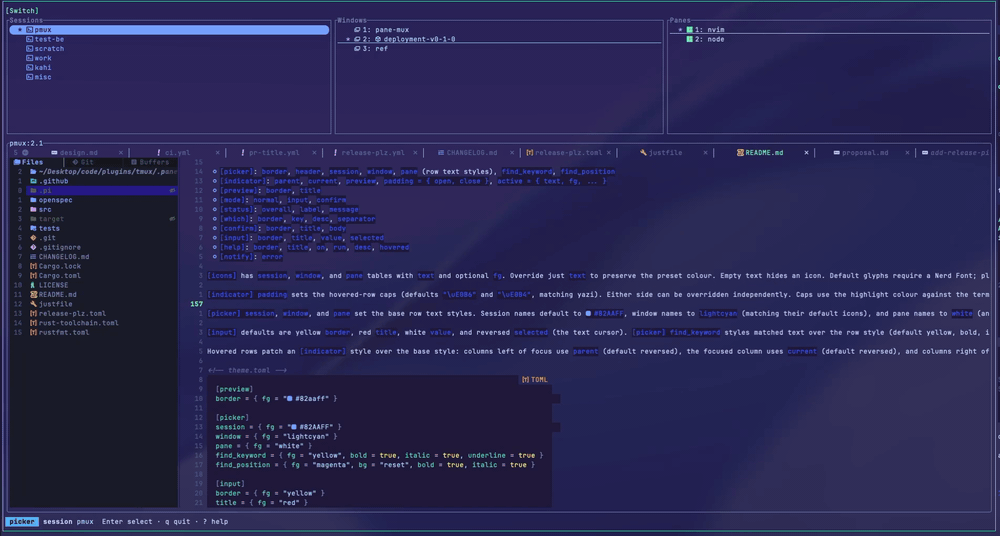

# pane-mux

<p align="center">
  <a href="#installation">Install</a> ·
  <a href="#quick-start">Quick start</a> ·
  <a href="#configuration">Configuration</a> ·
  <a href="#commands">Commands</a> ·
  <a href="CHANGELOG.md">Changelog</a>
</p>

---

A yazi-style terminal picker for tmux sessions, windows, and panes, written in Rust. It provides a three-column tree, a pane preview, configurable key bindings, and themes, with picked tmux targets intended for shell scripting.



## Installation

Install from crates.io:

```sh
cargo install pane-mux --locked
```

Or build from a source checkout:

```sh
cargo install --path . --locked
```

## Quick start

Add this binding to `~/.tmux.conf` to open the session switcher in a popup:

```tmux
bind o popup -w 75% -h 75% -x C -y C -E 'pane-mux switch-session'
```

Reload tmux (`tmux source-file ~/.tmux.conf`), then press `<prefix> o`.

See [docs/usage-examples.md](docs/usage-examples.md) for more examples.

## Configuration

The configuration directory is the first available of:

1. `$PANE_MUX_CONFIG_HOME`, if absolute.
2. `$XDG_CONFIG_HOME/pane-mux`, if `XDG_CONFIG_HOME` is absolute.
3. `$HOME/.config/pane-mux` (also on macOS).

Relative overrides are ignored. If no directory can be resolved, built-in defaults are used.

The directory may contain `config.toml`, `keymap.toml`, and `theme.toml`. Each file is optional; a missing directory is fine. Invalid TOML, unknown fields, invalid commands, and invalid values are errors naming the file; pane-mux then exits with code 2.

See [docs/configuration.md](docs/configuration.md) for picker settings, key bindings, find, theme, and the full defaults.

## Commands

- [`picker`](#pane-mux-picker---session--window--pane) - Pick a tmux target and print it to stdout
- [`switch-session`](#pane-mux-switch-session) - Pick a tmux target and switch the current client to it

For command help, run `pane-mux --help` or `pane-mux picker --help`.

### `pane-mux picker [--session|--window|--pane]`

Prints exactly one tmux target after closing the UI: a session name,
`session:window_index`, or `session:window_index.pane_index`. Without a level
flag, the focused column determines the output. The UI uses stderr (or
`/dev/tty` when stderr is redirected), leaving stdout available for scripts.

Sessions are listed by name. Level flags are mutually exclusive:
`pane-mux picker --session --pane` prints a usage error without opening the UI.

#### Options

- `--session`: Print the picked session name.
- `--window`: Print the picked window as `session:window_index`.
- `--pane`: Print the picked pane as `session:window_index.pane_index`.

#### Examples

```sh
# Capture a session and switch to it from a shell inside tmux
selected=$(pane-mux picker --session) && tmux switch-client -t "$selected"
```

### `pane-mux switch-session`

Requires tmux and switches the current client to the picked target, including
its window and pane when selected. It prints no target.

Sessions are listed current first, then most recently attached on the tmux
server. Ties are ordered by name; never-attached sessions come last, also by
name. The cursor opens on the session below the current one (the most recently
used other session), so `<Enter>` right away switches back to it; with no other
session it opens on the current one. The cursor stays on its session when the
list refreshes. Windows and panes keep their existing order.

#### Examples

```tmux
# ~/.tmux.conf
bind o popup -w 75% -h 75% -x C -y C -E 'pane-mux switch-session'
```

### Exit codes

| Exit code | Meaning |
| --- | --- |
| 0 | Picked successfully (and switched for `switch-session`) |
| 130 | Cancelled without picking |
| 2 | Error or invalid command-line usage |


## Releasing

Releases are automated with [release-plz](https://release-plz.dev):

1. Squash-merge pull requests into `main` with a
   [conventional commit](https://www.conventionalcommits.org) title such as
   `feat: add pane filter` or `fix(picker): keep cursor on refresh`. The PR
   title check enforces this; use `!` (for example `feat!:`) for breaking changes.
2. On each push to `main`, release-plz opens or updates a release PR that bumps
   the version in `Cargo.toml`/`Cargo.lock` and updates `CHANGELOG.md`.
3. Merging the release PR publishes the new version to crates.io, tags it
   `vX.Y.Z`, and creates a GitHub Release.
